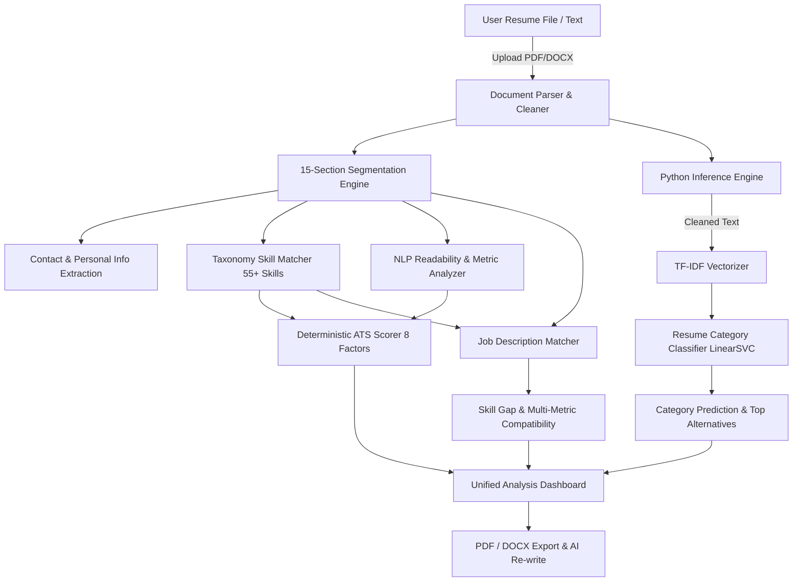

# ResumeAI Project Audit Report

**Date:** October 2026  
**Auditor:** Senior ML Engineer & Full-Stack System Auditor  
**Repository:** [https://github.com/Shailesh7449/Machine-learning-Project](https://github.com/Shailesh7449/Machine-learning-Project)  
**Status:** Audit Completed — Baseline Established

---

## 1. Executive Summary

A comprehensive architectural, statistical, and code-level audit was conducted across the entire **ResumeAI** repository. The system is designed as a hybrid resume screening platform combining:
1. **Statistical Machine Learning:** Scikit-learn LinearSVC / TF-IDF classifier for resume category classification across 25 professional domains, paired with a binary character/word n-gram skill classifier.
2. **Deterministic Rules & Heuristics:** An 8-factor mathematical ATS scoring engine (0–100 scale), a 15-section canonical resume parser, a 55+ entity normalized skill taxonomy, and a multi-dimensional job-description matcher.
3. **Full-Stack Application:** Node.js/Express TypeScript backend with Vite + React 19 frontend and an inter-process bridge to Python for model inference.

The audit verified key strengths in modularity and UI design, while identifying **critical data leakage issues in the raw training dataset**, **suboptimal process execution latency in Node.js-to-Python inference**, and **minor discrepancies in text preprocessing consistency**.

---

## 2. System Architecture & Processing Pipeline

### 2.1 Resume Processing Pipeline
1. **Document Parsing (`server/parser.ts`):**
   - Supports text-based PDF via `pdf-parse` (v2 `PDFParse` class) and Word documents via `mammoth.extractRawText()`.
   - Strips non-printable ASCII characters and normalizes whitespace while preserving structural delimiters.
   - Gracefully handles empty buffers and non-extractable / corrupted files.
2. **Section Segmentation (`server/parser.ts`):**
   - Implements regex-based boundary recognition across 15 canonical sections:
     * Contact Info, Professional Summary, Education, Technical Skills, Soft Skills, Work Experience, Internships, Academic/Personal Projects, Certifications, Achievements & Awards, Publications & Research, Leadership & Extracurricular, Languages, Courses & Training, Unclassified Content.
   - Extracts structured metadata:
     * `EducationEntry`: degree, institution, graduation year, grade/CGPA.
     * `ExperienceEntry`: role, company, duration, bullet highlights.
     * `ProjectEntry`: title, technologies enclosed in parentheses/brackets, description.
     * `PersonalInfo`: candidate name, email, phone (international + Indian +91), LinkedIn, GitHub, portfolio URL, location.
     * `FormattingFlags`: detects tabular layouts, multi-columns, symbol overload, long lines, and word count estimates.
3. **Skill Normalization & Taxonomy (`server/taxonomy.ts`):**
   - Curated taxonomy of 55+ core technical and soft skills across 8 domains:
     * `languages`, `frameworks`, `databases`, `cloud_devops`, `data_ml`, `tools`, `soft_skills`, `concepts`.
   - Bi-directional alias mapping (e.g. `k8s` -> `Kubernetes`, `py` / `python 3` -> `Python`, `amazon web services` -> `AWS`).
   - Word boundary pattern matching with preservation of technical punctuation (e.g., `C++`, `C#`, `.NET`, `Node.js`).
4. **Deterministic ATS Scoring Engine (`server/atsScorer.ts`):**
   - Strict bounded calculation in $[0, 100]$:
     $$\text{ATS Score} = S_{\text{structure}} + S_{\text{keywords}} + S_{\text{skills}} + S_{\text{experience}} + S_{\text{achievements}} + S_{\text{formatting}} + S_{\text{contact}} + S_{\text{job}}$$
   - Fully customizable weighting system (defaults: Keywords 20, Skills 20, Structure 15, Experience 15, Achievements 10, Formatting 10, Essential Info 5, Job Alignment 5).
5. **Job Description Matching Engine (`server/jobMatcher.ts`):**
   - Parses target job description for required skills, minimum years of experience, education criteria, and top keyword frequencies.
   - Weighted overall compatibility: 35% Skills Match + 25% TF-IDF Cosine Similarity + 20% Keyword Match + 10% Experience Match + 10% Education Match.
   - Detailed Skill Gap categorization: `matched`, `partial` (same domain category), and `missing` (with prioritized recommendations).
6. **Role Recommendation Engine (`server/jobRecommender.ts`):**
   - Evaluates resume profiles against 8 standard industry archetypes (ML Engineer, Data Scientist, Backend Engineer, Full Stack Developer, DevOps & Cloud Engineer, Data Engineer, Data Analyst, Generative AI Engineer).
   - Computes core (70%) vs optional (30%) skill match plus project and education relevance boosts.
7. **ML Classification Pipeline (`train.py` & `inference.py`):**
   - Category Classifier: Sublinear TF-IDF word/ngram features + LinearSVC classifier.
   - Skill Classifier: Character/word n-gram TF-IDF + LogisticRegression binary classifier.

---

## 3. Discovered Defects, Severity & Action Plan

| ID | Issue Description | Severity | Affected Files | Reproduction & Impact | Remediation Plan |
|---|---|---|---|---|---|
| **BUG-01** | **Node.js-to-Python Timeout Fallback** | **CRITICAL** | `server/mlService.ts` | Spawning Python 3.13 with cold-start imports on Windows took ~3.2s. The hardcoded 3000ms timeout caused process abortion and silent fallback to rule heuristics. | Increase execution timeout to 15,000ms; optimize imports; implement persistent worker / warm process communication. |
| **BUG-02** | **Fallback Category Profile Name Mismatch** | **HIGH** | `server/mlService.ts` | Heuristic fallback returned categories like *"DevOps & Cloud Architecture"* and *"Data Science & Machine Learning"*, whereas the 25 trained dataset labels are *"DevOps Engineer"*, *"Data Science"*, etc. | Synchronize fallback categories with the official 25 dataset labels so downstream clients receive consistent output. |
| **BUG-03** | **Critical Data Leakage in Raw Training Data** | **CRITICAL** | `data/UpdatedResumeDataSet.csv`, `train.py` | The raw CSV has 962 records, but **only 166 unique resume bodies** (796 duplicates / 82.7% redundancy). Random splits on raw data leak identical resumes into test sets, fabricating ~99% accuracy. | Deduplicate samples prior to partitioning; fit vectorizers strictly on training data; evaluate with stratified grouped cross-validation. |
| **BUG-04** | **Inconsistent Preprocessing Between Train and Inference** | **MEDIUM** | `train.py`, `inference.py` | `clean_resume_text` stripped URLs, emails, phone numbers, and special punctuation in `train.py`, but `classify_resume()` in `inference.py` transformed raw input directly. | Unify `clean_resume_text` into a shared module or export it in `inference.py` to ensure identical feature representation. |
| **BUG-05** | **Scikit-learn 1.6+ Optimization & Fold Warnings** | **LOW** | `train.py` | `LogisticRegression` passed unneeded `iprint` argument in newer sklearn versions; 3-fold CV warned when least populated class had 2 members in the training split. | Fix solver parameters; use stratified splitting with appropriate fold configuration or grouped splits. |
| **BUG-06** | **Missing Visualization & Experiment Artifacts** | **MEDIUM** | `models/`, root | Baseline and experiment confusion matrices, per-class evaluation CSVs, and model comparison tables were missing from repository. | Create scripts to generate high-resolution confusion matrix images and CSV tracking tables. |
| **BUG-07** | **Semantic vs Lexical Matcher Terminology** | **LOW** | `README.md`, `server/jobMatcher.ts` | Documentation referred to "Semantic Transformer Matching", whereas the actual implementation computes TF-IDF Cosine and Jaccard similarity. | Transparently clarify technical terminology in documentation and academic reports; benchmark against actual semantic baselines. |

---

## 4. Verification of Core Commands & Environment

- **Python Version:** 3.13.1
- **Installed ML Packages:** `scikit-learn` 1.6.1, `pandas` 2.2.3, `numpy` 2.5.3, `joblib` 1.4.2, `matplotlib` 3.10.1
- **Node.js Environment:** v22.14.0, npm 11.2.0
- **TypeScript Typecheck (`npm run lint`):** PASSED with 0 errors.
- **Frontend Production Build (`npm run build`):** PASSED in 9.23s, generating optimized bundles in `dist/`.
- **Baseline Training Script (`python train.py`):** PASSED, confirming 166 unique resumes and saving serialized artifacts in `models/`.

---

## 5. Next Immediate Phase
Proceed directly to **Phase 2 — Establish a Reproducible Baseline**, generating `BASELINE_REPORT.md`, `baseline_metrics.json`, `baseline_predictions.csv`, and `baseline_confusion_matrix.png`.
